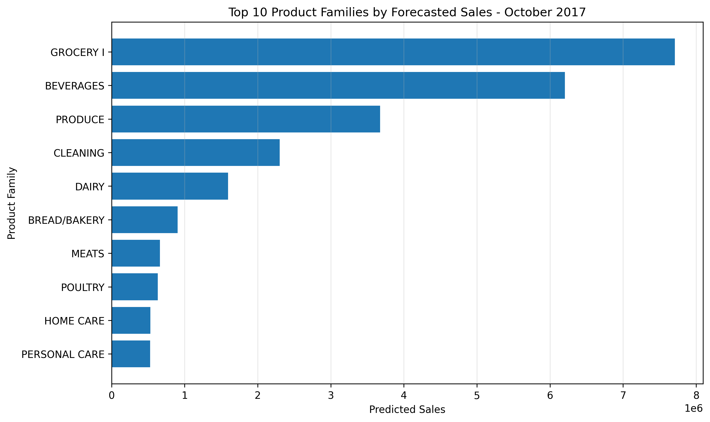
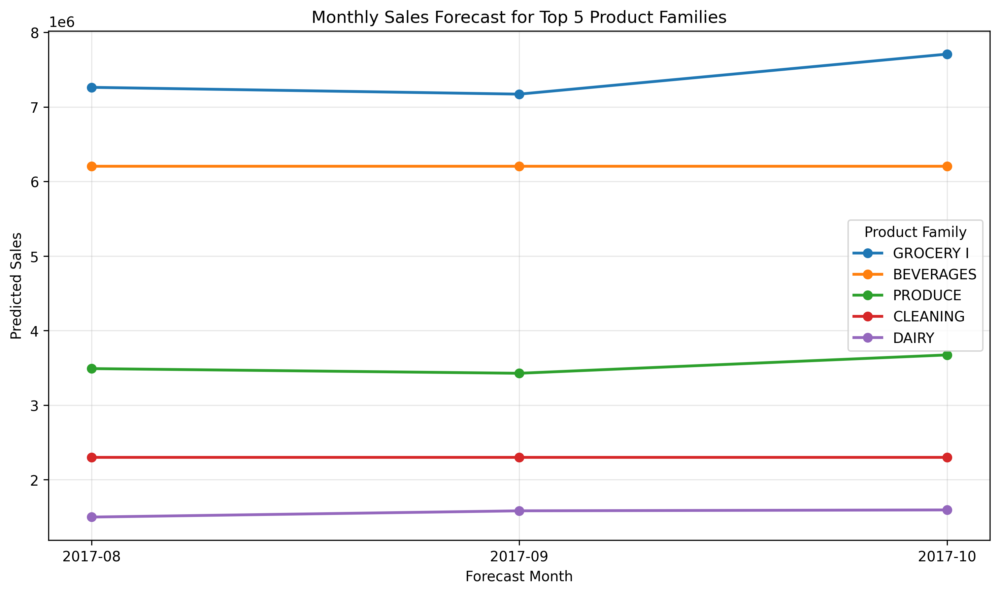

# Retail Sales Forecasting

## 1. Project Overview

This project forecasts monthly sales across 33 product families using historical retail data from Corporación Favorita.

The objective is to analyze historical sales patterns, compare forecasting models, and generate sales predictions for **August to October 2017**.

## 2. Dataset & Data Understanding

- **Source:** [Kaggle Store Sales - Time Series Forecasting](https://www.kaggle.com/competitions/store-sales-time-series-forecasting/data)
- **Original dataset:** 3,000,888 rows and 6 columns.
- **Historical period:** January 2013 to July 2017.
- **Modeling data:** 1,815 monthly observations across 33 product families.
- **Target variable:** `sales`, representing sales volume rather than revenue.

Daily sales were aggregated across all stores by month and product family.

## 3. Data Preparation & EDA

### Data Preparation

- Converted date values for time-series analysis.
- Aggregated daily sales into monthly sales by product family.
- Excluded incomplete August 2017 data from model development.
- Validated missing values, duplicate family-month combinations, and monthly coverage.

The final modeling dataset contains no missing values or duplicate family-month combinations.

### Key EDA Findings

- December had the highest average daily sales, approximately 453.74, while February had the lowest, approximately 320.93.
- MEATS showed relatively stable sales, with a coefficient of variation (CV) of approximately 0.09.
- BOOKS showed the highest relative variability, with a CV of approximately 2.97, including an extended period of zero sales.
- GROCERY I had a high absolute standard deviation of approximately 1.26 million, despite a lower CV of approximately 0.20.

These findings highlight differences in sales patterns across product families and motivate the evaluation of multiple forecasting methods.

## 4. Forecasting Methodology

Three forecasting approaches were evaluated:

| Model | Approach |
|---|---|
| Naive | Uses the latest observed sales value |
| Seasonal Naive | Uses sales from the same month in the previous year |
| Random Forest Lag 12 | Uses historical lag features and a machine learning model |

Time-series features included lag values (1, 2, 3, and 12 months), a three-month rolling mean, calendar month, and time index.

Models were evaluated using **rolling-origin validation** across five forecast origins, with horizons of one, two, and three months.

## 5. Model Evaluation & Findings

Model performance was assessed using MAE, RMSE, and WAPE. Each metric contributed equally to the average rank used to select one model per product family, with WAPE used as the tie-breaker.

### Selected Models

| Model | Product Families |
|---|---:|
| Seasonal Naive | 13 |
| Random Forest Lag 12 | 11 |
| Naive | 9 |
| **Total** | **33** |

The results show that no single forecasting method was selected for every product family.

### Model Stability

- The selected model was also the WAPE winner at individual validation origins in 97 of 165 comparisons (58.79%).
- For 22 of 33 product families, the selected model won at least three of the five validation origins.

This indicates that overall model selection does not guarantee the best performance at every forecast origin.

## 6. Final Forecast Results

The selected model for each product family was used to generate forecasts for August, September, and October 2017.

The final output contains **99 forecast records**: 33 product families across three months.

### Total Monthly Forecast


Total predicted sales decreased slightly from approximately 25.60 million in August to 25.52 million in September, before increasing to 26.45 million in October.

### Top 10 Product Families



GROCERY I had the highest predicted sales for October 2017, followed by BEVERAGES and PRODUCE.

### Monthly Forecast for Top 5 Product Families



Forecast patterns varied across product families. Some showed changes between months, while others remained relatively stable, partly reflecting the behavior of their selected forecasting methods.

All values represent predictions, not confirmed sales.

## 7. Business Insights & Recommendations

- **Inventory planning:** Use forecasts as one input when planning inventory for product families with high expected sales.
- **Category-level monitoring:** Review individual product-family forecasts because aggregate trends may hide differences between categories.
- **Model monitoring:** Reassess model performance as new actual sales data becomes available.
- **Unusual sales patterns:** Investigate categories with extended zero-sales periods or sharp changes before making operational decisions.

These recommendations are potential applications of the forecasting results, not measured business impacts.

## 8. Limitations & Future Improvements

### Limitations

- Forecasts were generated from historical monthly sales aggregated across stores.
- The modeling approach does not explicitly include promotions, holidays, or store-level differences.
- Model performance may vary across forecast origins and product families.
- Forecast accuracy for August to October 2017 cannot be confirmed without comparing predictions with actual sales.

### Future Improvements

- Evaluate forecasts against actual sales for the target period.
- Incorporate promotional and calendar-related features.
- Explore additional forecasting algorithms and benchmark their performance.
- Investigate unusual patterns in individual product families.

## 9. Repository Structure

```text
retail-sales-forecasting/
├── data/
│   ├── raw/
│   └── processed/
├── notebooks/
│   ├── 01_project_brief_data_understanding.ipynb
│   ├── 02_eda_preprocessing.ipynb
│   ├── 03_modeling_evaluation.ipynb
│   └── 04_final_forecasting.ipynb
└── reports/
    └── figures/
```

Processed data includes the monthly modeling dataset, model evaluation results, selected models, stability analyses, and final forecasts.

## 10. Tools & Technologies

- **Python:** Data processing and analysis
- **Pandas & NumPy:** Data manipulation and feature engineering
- **Matplotlib:** Data visualization
- **Scikit-learn:** Machine learning pipelines and Random Forest
- **Jupyter Notebook:** Analysis documentation and experimentation

## 11. How to Run the Project

1. Clone or download this repository.
2. Download the dataset from the [Kaggle competition page](https://www.kaggle.com/competitions/store-sales-time-series-forecasting/data).
3. Place `train.csv` in `data/raw/`.
4. Install the required Python libraries: `pandas`, `numpy`, `matplotlib`, and `scikit-learn`.
5. Open the notebooks in the `notebook/` directory and execute them in numerical order, from `01` to `04`.

Ensure that the notebook paths match the local project directory before running the code.